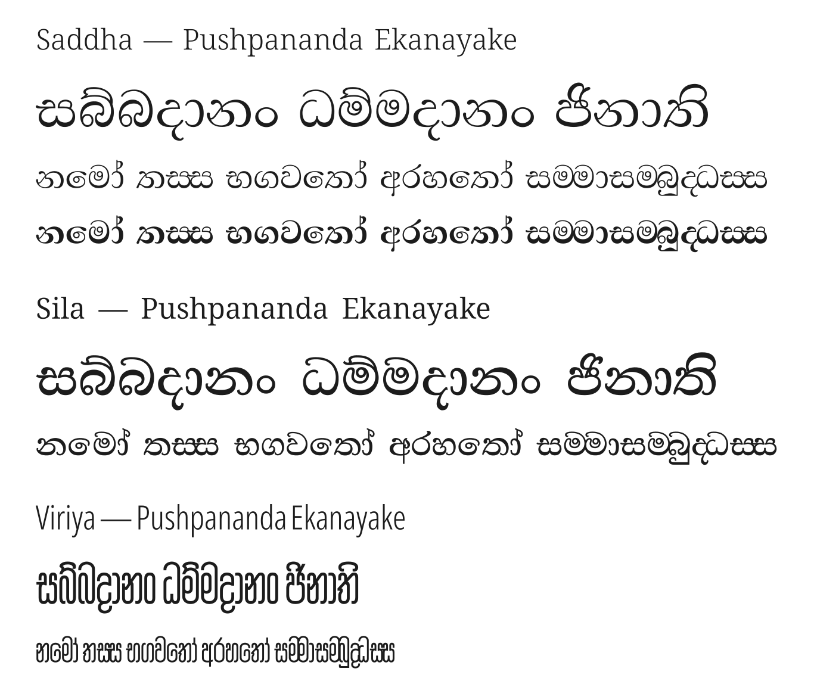

# Saddha, Seela and Viriya

Three Sinhala type families designed by **Pushpananda Ekanayake**, released under the SIL Open Font License 1.1.



| Family | Styles | Character |
|---|---|---|
| **Saddha** (සද්ධා, "confidence") | Variable weight 400–800 (Regular to ExtraBold) | A text face, from Pushpananda's own Regular and Bold drawings |
| **Seela** (සීල, "virtue") | Variable weight 400–800 (Regular to ExtraBold) | A classic text face with teardrop terminals, for traditional book typography |
| **Viriya** (විරිය, "energy") | Regular | A narrow display face for headings, posters and signs |

Pushpananda Ekanayake made these designs for a legacy (pre-Unicode) encoding. They have been converted to Unicode
and given full OpenType Sinhala shaping, including:
- conjuncts and touching letters (bandi akuru);
- rakaransaya, yansaya and repaya;
- Pali-specific forms such as ම්‍බ ණ්‍ඩ ඤ්‍ච, for Tipiṭaka and Pali text;
- a matching Latin (from Noto Serif and Noto Sans), with the Pali romanisation letters ā ī ū ṃ ṅ ñ ṭ ḍ ṇ ḷ.

Saddha's hairlines are a little heavier than in the original drawings (42 units of 1000 at the least), so that the
thin strokes hold on phone and monitor screens; the thick strokes, counters and spacing are as drawn. Seela's bold
master is derived from its Regular: each part of a letter gains weight where Abhaya Libre's Bold does.

The glyph set and the Sinhala OpenType features come from [Abhaya Libre](https://github.com/mooniak/abhaya-libre-font).

## Using the fonts

The ready-made fonts are in [`fonts/`](fonts): one folder per family, with `ttf/` (static fonts), `variable/`
(Saddha and Seela) and `webfonts/` (WOFF2).

## Building

The sources are UFOs in `sources/<Family>/`, with a designspace for the weight axis of Saddha and of Seela. Each family has a
`config.yaml` for [gftools builder](https://github.com/googlefonts/gftools):

```sh
python3 -m venv .venv
.venv/bin/pip install -r requirements.txt
cd sources/Saddha && ../../.venv/bin/gftools builder config.yaml
cd ../Seela && ../../.venv/bin/gftools builder config.yaml
cd ../Viriya && ../../.venv/bin/gftools builder config.yaml
```

## Licence

These fonts are licensed under the SIL Open Font License, Version 1.1 (see [OFL.txt](OFL.txt)). You may use,
share, modify and embed them, including commercially. The Unicode versions are released under a written
agreement with the designer, Pushpananda Ekanayake.

Authors: [AUTHORS.txt](AUTHORS.txt). Contributors: [CONTRIBUTORS.txt](CONTRIBUTORS.txt).
